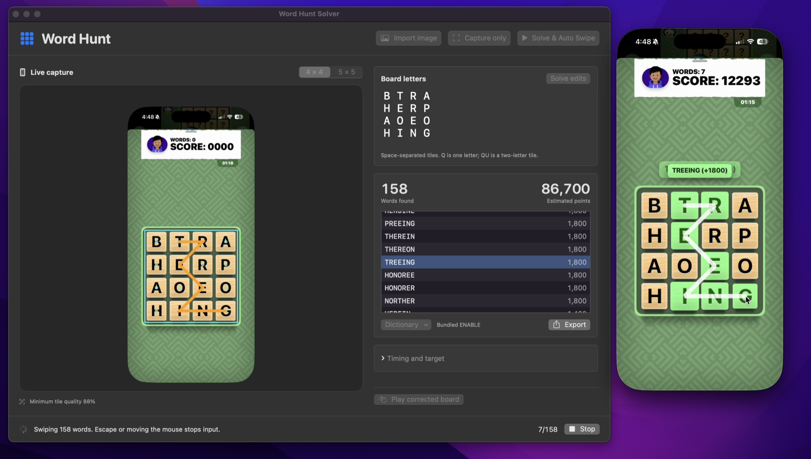

# Word Hunt Solver

Word Hunt Solver reads the GamePigeon board in iPhone Mirroring and swipes the words it finds. You can also solve a screenshot if you just want to see what you missed. The dictionary and letter recognition run on your Mac.

Download [Word Hunt Solver v1.0.0](https://github.com/JA-01/WordHuntSolver/releases/tag/v1.0.0) for Apple silicon Macs.



The demo shows the round from the tutorial screen to 86,700 points (45 seconds).

https://github.com/user-attachments/assets/04c81a9f-79c0-4134-b7a1-c566b1b1e30f

## Build and run

```sh
make run
```

You'll need macOS 14 or later and Swift 6 (Xcode or the Command Line Tools). For live play, you'll need macOS 15 or later, an iPhone on iOS 18 or later, and [iPhone Mirroring set up](https://support.apple.com/en-us/120421).

`make run` builds, signs, and opens `dist/Word Hunt Solver.app`. Use `make app` to build without opening it. The app is signed locally, not notarized. If you want to move it to `/Applications`, do that before granting permissions.

Live play won't work until you grant both **Screen Recording** and **Accessibility**. Use **Open Screen Recording Settings** and **Open Accessibility Settings** at the bottom of the app, then turn on Word Hunt Solver in each pane. macOS may call the first pane **Screen & System Audio Recording**. If the app isn't listed, click **+** and add it. Enable **Input Monitoring** only if the app asks for it.

If permissions stop working after a rebuild, quit the app, remove its old entries in **System Settings → Privacy & Security**, then add the rebuilt app.

## Play a round

Open a Word Hunt game in iPhone Mirroring and click **Solve & Auto Swipe** (⌘R). You can press **Start** before or after clicking it. Once the round starts, take your hand off the mouse. The app ignores the tutorial screen, waits for a stable board, and plays one round. Press **Escape**, click **Stop**, or use the mouse to cancel.

Pick **4 × 4** or **5 × 5** above the board preview. Under **Timing and target**, you can pick the Mirroring window and change the round budget. It defaults to 70 seconds from when the board appears. The app doesn't read the game's clock, so shorten the budget if you're starting late. If swipes miss letters, try increasing **Per tile** (35 ms by default) or **Word gap** (65 ms).

## Solve without swiping

**Capture only** (⇧⌘R) reads the live board without moving the mouse. **Import image** (⌘O) solves a screenshot, and **Load sample screenshot** gives you a board to try without a phone. Click any word to see its path.

If a letter is wrong, edit **Board letters** and click **Solve edits**. Use one row per line and separate tiles with spaces. `QU` is a two-letter tile; `?` means unreadable. With a live capture, you can then click **Play corrected board**. An imported screenshot can't be played.

Use the **Dictionary** menu to replace the bundled ENABLE list with a UTF-8 file (one word per line). **Export** saves the words, scores, and paths as JSON.

## How it works

The app captures the Mirroring window with ScreenCaptureKit and matches each tile against reference glyphs, with Vision as a fallback. Before swiping, it needs two matching reads with every tile at 80% match quality or better, then checks that the live board hasn't changed. It stops if the target moves or loses focus.

The solver searches neighboring tiles against a trie and keeps the shortest swipe path for each word. It picks the highest-scoring set that fits the time budget and swipes those words in order of estimated points per second. GamePigeon doesn't always accept the same words as ENABLE, so the swipe counter shows attempts, not accepted words.

## Command line

To solve from the terminal without moving the mouse:

```sh
swift run WordHuntSolver solve --board 'S T A R E N O T L I N E C A R E'
swift run WordHuntSolver image --image screenshot.png --json
swift run WordHuntSolver image --image screenshot.png --bounds 32,150,456,456
swift run WordHuntSolver sample --output sample-board.png
```

Use `--size 5` for a 5 × 5 board or `--dictionary PATH` for a custom word list. Image bounds are `x,y,width,height` in pixels from the top left. JSON paths use zero-based tile indices, left to right and top to bottom. The packaged executable accepts the same commands.

## Development

```sh
make build       # Build the debug executable
make test        # Run the unit tests
make smoke       # Offline run from screenshot to local replay
make live-smoke  # Live window capture and swipes on a local practice board
```

`make live-smoke` needs Screen Recording and Accessibility for your terminal and moves the mouse. It writes a report to `.build/system-smoke`.

The solver and dictionary are in `Sources/WordHuntCore`. Capture, recognition, and swipes are in `Sources/WordHuntMac`; the app and CLI are in `Sources/WordHuntSolver`.

## Credits

The bundled word list is ENABLE (public domain, by M. Cooper and Alan Beale). The letter samples come from [Ammaar-Alam/wordhunt-solver](https://github.com/Ammaar-Alam/wordhunt-solver) (MIT). See [THIRD_PARTY_NOTICES.md](THIRD_PARTY_NOTICES.md) for sources and licenses.
